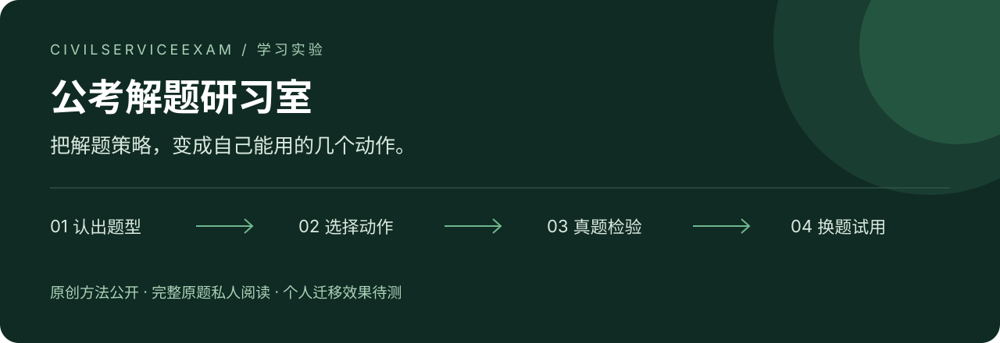

<p align="center">
  
</p>

<p align="center">
  <strong>AI 会做一道题之后，怎样让备考的人也会做下一道？</strong>
</p>

<p align="center">
  <a href="https://github.com/3013038780-design/civilserviceexam/raw/refs/heads/main/%E4%BD%93%E9%AA%8C%E5%85%A5%E5%8F%A3.html">开始一轮练习（下载HTML）</a> · <a href="公开上手与项目完善说明.md">了解项目</a>
</p>

---

这个项目从一次很直接的尝试开始：把 AI 解题时可核查的判断依据、名师资料中的方法和真题检验结果，整理成考生能理解、模仿并独立执行的动作。

**题目是检验方法的地方。最后留下的，应当是下一道题还用得上的策略。**

当前研究重点是言语理解与判断推理，新增题目以2010年及以后为范围。数量关系、图形推理暂缓专项。资料分析、申论等已有成果继续保留，暂不新增批量研究。

## 先走完一次：看示范 → 自己做 → 核验 → 留下动作

[下载单文件体验入口](https://github.com/3013038780-design/civilserviceexam/raw/refs/heads/main/%E4%BD%93%E9%AA%8C%E5%85%A5%E5%8F%A3.html)，保存后用浏览器打开。默认只显示当前一步，其他研究资料收在底部。

下文预测一份白话示范，接3道原创自拟练习：选择、依据、自填用时先保存，再展开核验，最后写下一题的动作，可导出JSON。无需登录、导入题库或配置AI。它用于体验方法，不是考场难度测评；个人效果仍待独立真题验证。

<details>
<summary>完整资料包、研究与私人网站入口</summary>

[下载六部分资料包v2](https://github.com/3013038780-design/Machine-Observer-WeChat-Official-Account/raw/refs/heads/main/articles/2026-10-ai-kaogong/assets/AI%E8%80%83%E5%85%AC%E8%B5%84%E6%96%99%E5%8C%85-%E5%AE%8C%E6%95%B4%E9%98%85%E8%AF%BB%E7%89%88-v2.zip)，解压打开 `00-从这里开始.html`。含指引、七份预设、六张方法卡、三组真题与项目介绍。

完整站点仍为私人访问。详见[项目现状与完善说明](公开上手与项目完善说明.md)。

</details>

<details>
<summary><strong>展开完整分类成果、证据和维护说明</strong></summary>

## 先看一个例子

遇到“这段文字接下来最可能讲什么”，几个选项可能都和主题有关。此时继续检查：

> **文章现在讲到哪儿？留下什么还没解释？哪个选项接得最近？**

2015年国考副省级行测第44题，结尾说影院不同电影同价“仍然利大于弊”，却还没讲为什么。接“同价对影院更有利的原因”，比重新展开“电影定价的主要参考因素”更贴近当前进展。

这条方法保留的是接续关系。换一道题，未展开的内容也可能是新概念或工作原理，不能背成“下文一律选原因”。

[阅读分类方法与跨年示范](https://github.com/3013038780-design/civilserviceexam/blob/codex/corpus-strategies/行测分类通用方法.md) · [查看结构化教学分支](https://github.com/3013038780-design/civilserviceexam/blob/codex/corpus-strategies/web/content/xingce-branches.json)

## 已经整理出什么

截至2026年10月20日，以下是已有方法和证据状态。各分支的研究深度不同，未把所有流程都算作完成。

| 题型 / 任务 | 可以模仿的动作 | 当前状态 |
| --- | --- | --- |
| 定义判断 | 拆必要条件，分清且／或；区分满足、明确冲突、未交代 | 已有成组逐题检验、回查与边界记录 |
| 资料分析 | 先对齐对象、时间、分母、单位；根据选项决定精度 | 已有成组逐题检验，历史成果保留 |
| 主旨、意图 | 压缩核心对象与关系，再比范围、作用和强度 | 已有跨年检验与失败修订 |
| 句子排序 | 先找有依据的局部连接，排除后再通读 | 已有跨年检验、教学流程与试用 |
| 填句、插句 | 判断句子功能；同时检查前接与后续 | 已有教学分支，保留争议与适用边界 |
| 下文预测 | 对齐正反设问与阅读范围，比较未展开的接续方向 | 已有跨年检验、正反方向与试用 |
| 阅读、选词、逻辑、类比 | 按真实任务分流，整理已有策略与反例 | 已有部分样例，继续扩验 |
| 申论 | 任务识别 → 材料证据 → 要点组织 → 关系与论证 | 2026副省级五题首答核验与材料映射已保留 |

**个人迁移待测。** 助手能用、答案一致、页面上线，分别说明不同的事；最终效果要看考生无辅助、限时完成未讲过的题。尚无个人提分结论。

## 学习网站里有什么

最近核验的私人线上版本包含：

| 学习入口 | 已有内容 |
| --- | --- |
| 原题学习 | 2026副省级行测135题入口，原题、示范与分类方法相互跳转 |
| 分类方法 | 35张方法卡；其中26个分支带流程与示范 |
| 换题试用 | 78道答案分离的试用题：67道真题、11道自拟题 |
| 跨年示范 | 已整理来源可从分类进入，保留题号、方法、依据及争议 |
| 申论与书架 | 五题申论及已整理的材料、方法与研究文档 |

[打开私人研习室](https://gongkao-study-studio.easy-tern-3117.chatgpt.site/) · [阅读网站使用说明](https://github.com/3013038780-design/civilserviceexam/blob/codex/corpus-strategies/网站使用说明.md)

网站目前仅所有者访问。公开仓库展示代码、原创方法和索引；完整题库、原卷与私人作答包不在这里分发。网站是学习页面，尚未接入在线模型答题、自动评分或跨设备笔记同步。

## 从哪里开始

| 你想看什么 | 阅读入口 |
| --- | --- |
| 先理解不同题型怎么下手 | [分类通用方法](https://github.com/3013038780-design/civilserviceexam/blob/codex/corpus-strategies/行测分类通用方法.md) · [十一类读题地图](https://github.com/3013038780-design/civilserviceexam/blob/codex/corpus-strategies/行测十一类读题地图.md) |
| 看行测教学如何执行 | [xingce-strategy](https://github.com/3013038780-design/civilserviceexam/blob/codex/corpus-strategies/.agents/skills/xingce-strategy/SKILL.md) |
| 看申论如何从材料组织答案 | [shenlun-strategy](https://github.com/3013038780-design/civilserviceexam/blob/codex/corpus-strategies/.agents/skills/shenlun-strategy/SKILL.md) · [申论首轮策略](https://github.com/3013038780-design/civilserviceexam/blob/codex/corpus-strategies/申论首轮策略卡.md) |
| 找花生、申论与复盘等外部方法 | [外部 Skills 参考索引](https://github.com/3013038780-design/civilserviceexam/blob/codex/corpus-strategies/外部Skills参考索引.md) |
| 看验证依据与进度 | [训练与验收](https://github.com/3013038780-design/civilserviceexam/blob/codex/corpus-strategies/训练推进与验收.md) · [首轮核验](https://github.com/3013038780-design/civilserviceexam/blob/codex/corpus-strategies/资料/2026副省级/AI首答核验摘要.md) · [跨卷检验](https://github.com/3013038780-design/civilserviceexam/blob/codex/corpus-strategies/行测方法跨卷验证摘要.md) |
| 参与维护或了解工作规则 | [AGENTS.md](https://github.com/3013038780-design/civilserviceexam/blob/codex/corpus-strategies/AGENTS.md) · [当前 OpenSpec 任务](https://github.com/3013038780-design/civilserviceexam/blob/codex/corpus-strategies/openspec/changes/read-corpus-and-build-transferable-skills/tasks.md) |

方法、代码与研究文档当前在 [`codex/corpus-strategies`](https://github.com/3013038780-design/civilserviceexam/tree/codex/corpus-strategies) 分支迭代；以上链接直接指向该分支，避免从首页进入早期版本。

<details>
<summary><strong>想自己调用教学 Skill？</strong></summary>

在支持项目 Skills 的客户端打开研究分支，并按需要读取对应 `SKILL.md`：

```text
使用 $xingce-strategy 分析这道题：先给最简可靠解法，说明识别信号、依据和停止条件。
使用 $shenlun-strategy 分析题干与材料：先列材料证据，再说明要点怎样组织。
```

Skills 是方法与执行协议，由宿主 AI 读取；资料整理与规则迭代不等于训练模型权重。外部方法按题型读取具体文件，实际采用时附出处、适用条件和本题核验。

</details>

<details>
<summary><strong>资料与研究边界</strong></summary>

- 题源、首答、核验与修订分别保存，不覆盖旧答来改善正确率。
- 答案一致仍检查理由；争议与知识缺口保留，不强行凑出万能规则。
- 可核查策略用于教学，不声称复现模型隐藏思考记录。
- 第三方真题、课程、电子书与个人笔记只作私人研究，不随公开仓库分发；具体使用见[资料说明](https://github.com/3013038780-design/civilserviceexam/blob/codex/corpus-strategies/资料使用说明.md)。
- 最新范围与工作顺序以研究分支 `AGENTS.md` 为准。历史“50单元”“44天”等是当时的目录或计划口径，不作当前完成率。

</details>

</details>
