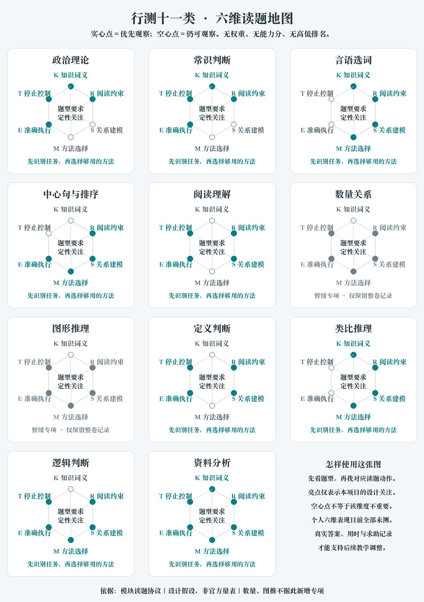

# 行测十一类读题地图

先识别题目要求，再执行对应的最小动作。这十一类沿用用户训练分组，并非固定命题目录；中心句与阅读理解有交叉时，每题只归入一个训练单元，另记细分题型。

[查看可编辑SVG](图示/行测十一类六维任务图.svg)。实心点表示本项目读题协议优先观察的维度，空心点仍可观察；所有点位距离相同，没有数值、权重或能力排名。这是教学设计假设，不能作为官方量表。数量与图推保留原分组位置，不增加专项。

## 各类题怎样启动，何时停止

| 训练单元 | 起手读什么 | 最小动作 | 何时可停 | 常见陷阱 |
| --- | --- | --- | --- | --- |
| 政治理论 | 正误方向、时点、主体与限定；组合题逐项读 | 对照自己有依据的准确命题，分别判定后再组合 | 已判定的信息足以唯一定位，且没有未核关键项 | 语气积极就判对；用新政策改旧题；从三项推第四项 |
| 常识判断 | 正选还是选非、领域与对象 | 从确定知识项入手；排除须说明具体事实矛盾 | 唯一项有事实支持或其他项有确定错误 | 绝对词必错、生活直觉替代法律或科学事实 |
| 言语选词 | 解释、转折、搭配对象、程度及全部空 | 选区分度最高的一空先排，再把候选代回所有空 | 每个空均符合语义、搭配与上下文关系 | 一空顺口便选；凭孤立近义词印象 |
| 中心句与排序 | 先辨主旨还是排序；主旨看关系，排序看指代与衔接 | 主旨压缩全文对象与判断；排序找稳定连接再检查全段 | 主旨唯一贴合且不失必要对象；排序局部和全段都顺 | 转折后必是中心；代词必紧邻；只检查一个连接 |
| 阅读理解 | 题目问细节、推断、词句还是续写；定位范围 | 将选项对应到证据，区分原文、允许推断和新增信息 | 选项范围、主体与强度均有支撑，其余不符 | 用常识替代原文；将局部效果扩大为全文结论 |
| 数量关系 | 当前仅记录整卷题号、作答与跳题 | 不主动追加专项；按已定考试取舍执行 | 已完成决定与填涂记录，未证实的猜答不算会做 | 因AI本卷全对就改变用户投入策略 |
| 图形推理 | 当前仅保留完整图与实际把握记录 | 不主动追加专项；看不清的图不猜规律 | 能说明是否有排他依据；猜中单列 | 把事后知道规律倒写为首答能力 |
| 定义判断 | 正选/选非，定义中的对象、行为、条件与结果 | 圈最区分选项的必要条件，逐项比对；再核剩余条件 | 目标项的满足或缺项有据，其他候选已排定 | 题外专业概念增加限制；开放列举误当穷尽 |
| 类比推理 | 词义、关系方向、层级和关系强弱 | 把题干写成准确关系句，再用同一句检查选项 | 关系和方向都匹配，而不只是话题相关 | 都有关联便算同关系；因果与组成混用 |
| 逻辑判断 | 先分加强、削弱、前提、解释、演绎或组合 | 论证找证据到结论的缺口；演绎保留条件方向；组合列约束 | 论证回应关键缺口；演绎有必然依据；组合满足全部条件 | 所有题都按加强做；相关当因果；必要充分倒置 |
| 资料分析 | 所求量、时段、对象、单位、口径，随后看选项分界 | 定位必要数据、统一口径、列式，再选能区分选项的精度 | 已证明落入唯一选项区间，且单位和正负正确 | 增长率相减；累计随意差分；粗估跨界；大数相减放大误差 |

以上是读题入口，不覆盖每一细分题的全部方法；具体动作以题面为准。已整理的[四张方法卡](行测首轮方法卡.md)提供来源、例题与边界，135题本地教学提供实际演示。不能把“最小动作”读成允许省略排他性核验。

## 六维如何观察个人表现

目前个人各维均为**未测**。拿到真实答案、用时和必要的自述后，再按下列证据描述，不根据单一总分画高低雷达。

| 维度 | 可观察证据 | 不能凭什么推断 |
| --- | --- | --- |
| K 知识词义 | 能给事实或词义依据，或明确承认缺知识 | 猜对不等于知道，选错也未必就是缺知识 |
| R 阅读约束 | 正误方向、范围、时点、单位和限定识别准确 | 不能从答案字母推测漏读哪个词 |
| S 关系建模 | 能写出句间关系、必要条件或量的关系 | 看懂长解析不等于能独立建模 |
| M 方法选择 | 能说明为何选该方法、何时换方法或提高精度 | 列出三种方法不等于会选择 |
| E 准确执行 | 实际步骤中不漏条件，计算与单位能核查 | 只看最终选项不能定位执行错误 |
| T 停止控制 | 有足够依据时停止；记录真实耗时与跳题 | AI响应速度或一次无计时答对不代表考场效率 |

可以暂记“有独立证据／需提示／未测”，并附题号和证据；不汇总为未经验证的能力分。整卷中不要求逐题口述打断计时，先记作答与题组时间，再对少量代表题追问关键选择。

## 图示维护

图示直接读取[模块读题协议](.agents/skills/xingce-strategy/references/modules.md)的重点维度，避免两处手工录入。生成脚本为`scripts/生成行测六维任务图.py`，依赖Pillow和含中文字体；其他系统可用`--font 字体路径`。维度调整须有教学或真实作答依据，不能为了图形好看增加分值。
